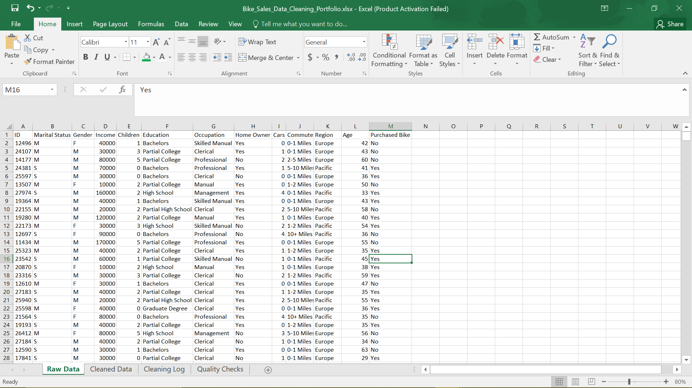
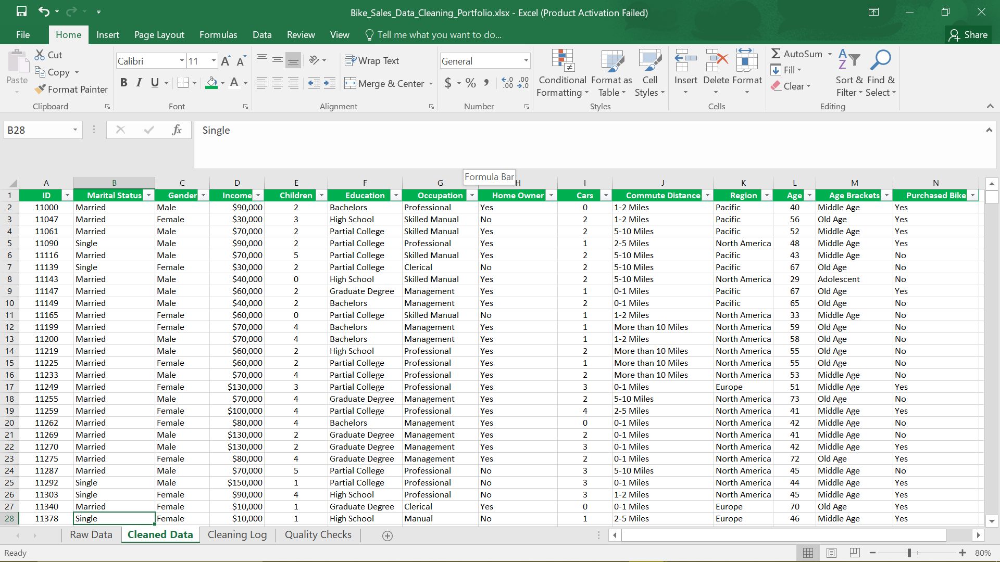

# Bike Sales Data Cleaning Project

## Overview
I cleaned and standardised a raw dataset of 1,026 customer records from the Bike Buyers dataset (Kaggle) so it was consistent, accurate and ready for analysis.

## Tools Used
Microsoft Excel: Remove Duplicates, Find & Replace, IF formulas, Sort, Filters, Format Cells, COUNTA / COUNTIF / COUNTBLANK

## What I Did
1. Removed 26 duplicate records (1,026 → 1,000 rows)
2. Standardised Marital Status (M/S → Married/Single)
3. Standardised Gender (M/F → Male/Female)
4. Made Commute Distance labels consistent ("10+ Miles" → "More than 10 Miles")
5. Cleaned Income formatting (removed decimals)
6. Created an Age Brackets column with an IF formula
7. Sorted records by ID and added filters to all columns

## Quality Checks
- Raw rows: 1,026 | Cleaned rows: 1,000 | Duplicates removed: 26
- Blank cells in cleaned data: 0

## Files
- `Bike_Sales_Data_Cleaning_Portfolio.xlsx`: Raw Data, Cleaned Data, Cleaning Log and Quality Check tabs
- Screenshots in the `/screenshots` folder

## Before and After

## Contact
Appiah Samuel | appiahsamuelcobby34@gmail.com | www.linkedin.com/in/samuel-appiah-
